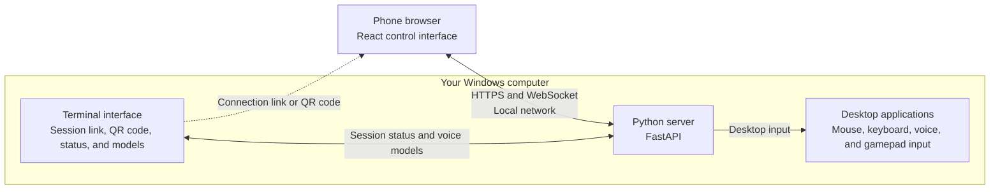

```text
  _____ ____  _____ _______ ________   _________
 / ____/ __ \|  __ \__   __|  ____\ \ / /__   __|
| |   | |  | | |__) | | |  | |__   \ V /   | |
| |   | |  | |  _  /  | |  |  __|   > <    | |
| |___| |__| | | \ \  | |  | |____ / . \   | |
 \_____\____/|_|  \_\ |_|  |______/_/ \_\  |_|
```

**Control your computer from your phone.**

Cortext turns your phone into a touchpad, keyboard, microphone, and game controller for your computer. Start the server on your computer, open the connection link on your phone, and use the browser interface to send input to your desktop.

This is an evolving personal project. The current setup targets Windows, and the phone interface runs in a browser. A packaged mobile app is not required.

## What you can do

| Input | Features |
| --- | --- |
| Mouse | Move the cursor, click, drag, scroll, adjust sensitivity, and zoom with keyboard shortcuts. |
| Keyboard | Send a block of text or type live, use extra keys, and send desktop shortcuts. |
| Voice | Record audio, transcribe it locally with Whisper, review the text, and insert it into the active application. |
| Controller | Use a virtual Xbox controller with sticks, triggers, face buttons, a D-pad, and an editable layout. |

Resize the touchpad and input panels, hide controls you do not need, and use fullscreen mode. Controller layout preferences are saved in the phone's browser. Haptic feedback depends on the device and browser.

## How it works



The computer runs a FastAPI server and serves the React control interface. HTTP requests and a shared WebSocket carry input from the phone. Python handles desktop mouse and keyboard input, voice transcription, and the virtual gamepad.

The `landing/` website is a separate public showcase. Its interactive demo simulates a laptop; it does not control your computer or require the Python server.

## Before you start

- A Windows computer. The launch scripts and controller integration currently target Windows; other systems have not been validated for this setup.
- **Python 3.13**, matching the project's current local environment.
- **Node.js 22** and npm, matching the current development setup.
- A phone with a browser, connected to the same local network as the computer.
- Internet access to install dependencies and download voice models for the first time.
- For controller input, the **ViGEmBus** virtual gamepad driver used by `vgamepad`.

The [vgamepad installation instructions](https://github.com/yannbouteiller/vgamepad#installation) describe its Windows driver installer. It may appear while installing the Python dependencies. If the driver is missing, use the [official ViGEmBus releases](https://github.com/nefarius/ViGEmBus/releases). The driver is needed for controller input; the other input modes do not use it.

## Set up Cortext

Download the repository using GitHub's **Code → Download ZIP**, or clone it with Git. Extract it if needed, then open PowerShell in the repository's root folder—the folder containing `run_backend.bat`.

### 1. Install dependencies

Create the Python environment expected by the launch scripts:

```powershell
cd backend
py -3.13 -m venv venv
.\venv\Scripts\python.exe -m pip install -r requirements.txt
cd ..
```

These commands use the environment's Python directly, so you do not need to activate it or change PowerShell's execution policy.

Install the phone interface's dependencies:

```powershell
cd web
npm.cmd ci
cd ..
```

You do not need to install `landing/` to use Cortext.

### 2. Start the server and terminal interface

From the repository root, start the server:

```powershell
.\run_backend.bat
```

The script builds the phone interface, generates a self-signed local HTTPS certificate if needed, and starts the server on port **8001**. Keep this window open.

Open a **second PowerShell window** in the repository root and run:

```powershell
cd backend
.\venv\Scripts\python.exe -m tui.main
```

In the terminal interface, choose **New Session** to see the connection link and QR code. Starting a session does not start the server for you; both windows need to stay open.

### 3. Connect your phone

Scan the QR code or open the full session link in your phone's browser. It looks like:

```text
https://<your-computer-local-ip>:8001/app?token=<session-token>
```

Use the link provided by Cortext. The address is your computer's local network address, and the token authorizes input. `localhost` on your phone points to the phone, not your computer.

The browser may show a certificate warning because the certificate is generated locally. Verify that the address is your computer before continuing. Microphone recording needs HTTPS, microphone permission, and a secure context accepted by your browser; some devices may require trusting the local certificate.

Open a text editor on your computer, place the cursor in it, and try sending a short message from the phone. Mouse and keyboard input go to the currently active desktop application.

To stop Cortext, close the terminal interface and press **Ctrl+C** in the server window.

## Voice and controller setup

**Voice:** With the server running, choose **Models** in the TUI and download a model. `tiny` is the quickest starting point; `base` is the default. The available models are `tiny`, `base`, `small`, and `medium`. Downloads need internet access; downloaded models are cached. Transcription currently runs on the CPU and is configured for English. On the phone, open the voice panel and allow microphone access.

**Controller:** Complete the ViGEmBus driver installation, then switch to the controller view on the phone. Cortext emulates an Xbox 360 controller. The game or application you want to use must support gamepad input. Use the pencil control to edit the HUD and the controller options to show or hide controls.

## Troubleshooting

| Problem | What to check |
| --- | --- |
| The phone cannot open the link | Keep the server running, put both devices on the same network, and check that Windows Firewall allows the server on your private network. Guest Wi-Fi may isolate devices. |
| Input is rejected or disconnected | Open the complete TUI session link, including `?token=...`. |
| Typing has no effect | Focus a text field on the computer. Confirm that the phone is using the local control app rather than the showcase demo. |
| The microphone is unavailable | Use the HTTPS session link, allow microphone access, and check the browser's certificate/security status. |
| Transcription is slow | Try a smaller downloaded model and a shorter recording. |
| Controller input is unavailable | Check the `vgamepad` installation and ViGEmBus driver, then restart Cortext after installing the driver. |
| The interface shows an old version | Stop the server and run `run_backend.bat` again to rebuild `web/`, then refresh the phone. |
| Port 8001 is already in use | Stop the previous server before launching another one. |

Keep the server on your local network. The session link grants control of your computer, so keep its token private. Generated certificates, the session token, dependencies, and build output are excluded by `.gitignore`.

## Project structure

```text
cortext/
├── backend/                 Python server and terminal interface
│   ├── app/                 API routes, desktop input, and transcription
│   ├── tui/                 Connection screens and model management
│   ├── scripts/             Local HTTPS certificate generation
│   ├── tests/               Backend tests
│   └── requirements.txt     Python dependencies
├── web/                     React phone control interface
│   └── src/                 Mouse, keyboard, voice, controller, and layout
├── landing/                 React public showcase and setup docs
│   └── src/                 Pages, sections, shared components, and demo
├── run_backend.bat          Build the phone UI and start the HTTPS server
└── run_tui_dev.bat          Run the TUI with development reloads
```

## Development

Each React app has its own `package.json`. Run npm commands inside `web/` or `landing/`, not at the repository root.

Both frontends use the shared Prettier configuration at the repository root: two-space indentation, single quotes, and consistent line wrapping. Run `npm.cmd run format` to format a frontend, or `npm.cmd run format:check` to check it without changing files.

### Phone interface

Keep the backend running, then open another terminal:

```powershell
cd web
npm.cmd run dev
```

Open `http://localhost:5173/app/?token=<session-token>` on the computer with the token from the TUI link. Vite proxies input requests to the local backend. For microphone testing on the phone, use the backend's HTTPS session link.

More details: [web/README.md](web/README.md).

### Public showcase

```powershell
cd landing
npm.cmd ci
npm.cmd run dev
```

Open `http://localhost:5174/`. This runs independently of the backend and includes an interactive simulation using the real phone UI. Voice transcription needs the local app.

For builds and Vercel configuration, see [landing/README.md](landing/README.md). Only the public showcase is intended for Vercel; the desktop control server stays on your computer.

### Checks

Run these separately from the repository root:

```powershell
cd web
npm.cmd test
npm.cmd run build
cd ..

cd landing
npm.cmd test
npm.cmd run build
cd ..

cd backend
.\venv\Scripts\python.exe -m unittest discover -s tests
```

The backend's frontend-serving tests expect the `web/` build to exist.
